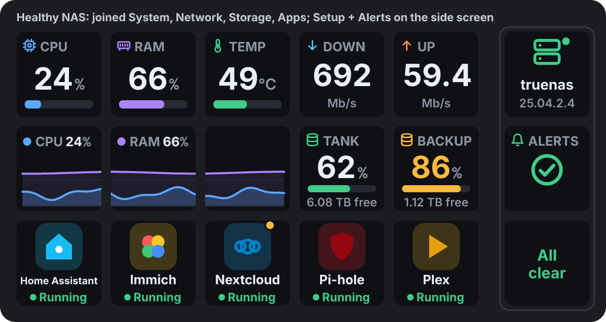

# TrueNAS

A plugin for the Ajazz "Stream Dock AJAZZ Global" software (3.10.x) on the AKP153E (5 x 3 keys plus the side screen). It shows live stats from a TrueNAS server on your keys: CPU, memory, temperature, network speed, storage pools, alerts and apps. It can also start and stop TrueNAS apps.

- **Plugin ID:** `com.clarkyau.truenas`
- **Version:** 1.2.0 (18 Oct 2026)
- **Needs:** TrueNAS 25.04 or newer (Community Edition, formerly SCALE), Windows 10 or newer, and the Ajazz software. Nothing else to install: it runs on the Node 20 inside the Ajazz software.
- **Connection:** TrueNAS's own API over a secure connection (`wss://<address>/api/current`) with an API key. The key is never sent unencrypted and never written to the log.

## Keys and settings

All settings are in the Ajazz settings panel and apply as you change them. Each key's panel only shows its own options.

**Setup key.** This is the only place you enter the connection details:
- Address (e.g. `192.168.1.20` or `truenas.local`), API key, and "Allow self-signed certificate" (on by default).
- The key itself shows whether it's connected, plus the NAS name and version. Pressing it opens the TrueNAS web page, or retries if it can't connect.
- Other keys say "Add the Setup key" or "Finish the Setup key" until the setup is done.

**System:** CPU, memory, CPU temperature, ZFS cache, uptime, or a CPU/RAM graph.
- Settings: Shows, Temperature (°C or °F).
- Press: opens the TrueNAS dashboard.

**Network:** download and upload speed, the port and its link speed, or a graph.
- Settings: Shows, Port (or all ports), Speed in bits or bytes.
- Press: opens network settings.

**Storage pool:** how full a pool is, free space, health (including scrub or resilver progress), or all pools added up.
- Settings: Shows, Pool.
- Press: opens storage.

**Alerts:** the number of active alerts, or one alert per key, worst first.
- Settings: Shows.
- Press: opens the dashboard.

**App:** an app's icon, name and state. The tile takes its colour from the app's icon.
- Settings: App (or Automatic).
- Press: starts a stopped app. Press twice within 3 seconds: stops a running app (the first press shows "Stop?"). Hold for under a second: opens the app's web page.

**Joining keys.** Keys of the same kind next to each other join into one display.
- Every key has a **Shows** setting. **Automatic** (the default) picks what to show from the key's position. Examples:
  - A row of Network keys: Download, Upload, then a graph across the rest.
  - A row of System keys: CPU, Memory, Temp, ZFS cache, Uptime, with a graph on a second row.
- You can choose what any key shows, even inside a group.
- Neighbouring keys set to Graph share one graph. The gap between keys is allowed for, so lines meet up.
- "Join with neighbouring keys" can be turned off per key.
- The main keys and the side screen never join.

## What is tested, and what needs your hardware

Tested without the hardware (35 tests, on Node 20.8.1, the same version the Ajazz software uses):
- The real built plugin runs against a fake Ajazz host and a fake TrueNAS server (secure connection with a self-signed certificate, with a "healthy" and a "problems" scenario).
- Setup messages and error messages, settings applying live, and starting and stopping apps.
- Joined layouts and per-key "Shows" choices.
- Moving settings over from the old plugin name.
- Every key picture is checked for things that break the Ajazz software: no "#" or "%", 144 x 144 size, no text under 17 px.
- The installer was run on a pretend plugins folder (install, reinstall, uninstall, and removing the old folder name).

Confirmed on the author's deck: it connects, all keys draw, the sizes read well, and the settings move from the old name worked.

Needs your hardware or NAS:
- Your TrueNAS version. The TrueNAS calls were checked against TrueNAS's own source code for 25.04 and 25.10.
- Starting and stopping apps needs an API key for an admin user. A read-only admin key works for everything else.
- App icon pictures on the keys (if not, a tinted tile with the app's first letter shows instead).

## Install (plain steps)

1. Download `releases/com.clarkyau.truenas-1.2.0.zip` and unzip the whole thing (right-click > Extract All).
2. Double-click `install.bat` inside the unzipped folder. It closes the Ajazz software, copies the plugin in and starts the software again. Your keys and settings are kept, and an older copy named `com.homelab.truenas` is removed.
3. In the Ajazz software, open the **TrueNAS** group and drag the **Setup** key onto your deck.
4. Click the Setup key and enter your TrueNAS address and an API key. To make one: TrueNAS web page > your user icon (top right) > My API Keys > Add. TrueNAS only shows the key once, so copy it straight away.
5. Add any other TrueNAS keys you want.

To remove it: double-click `uninstall.bat` from the same unzipped folder.

`install.bat` and `uninstall.bat` in this folder are copies for reference. They need the plugin files and `installer.ps1` next to them, so run them from inside the unzipped build zip.

## Folder contents

- `releases/` has the build zip (ready to install) and the source zip.
- `source/` has the full source: `src/` (plugin code), `pi/` (settings panel), `assets/` (manifest, names, icons), `installer/`, `scripts/` (build, package, icons, zip), `test/` (fake Ajazz host, fake TrueNAS, tests), `tools/` (the one-off helper used when the plugin was renamed), `docs/previews/`.
- To rebuild: `npm install`, `npm run build`, `npm test`, `npm run package`. See `source/README.md` for details.
- `NOTES.md` has the decisions and lessons. `CHANGELOG.md` has the version history.
