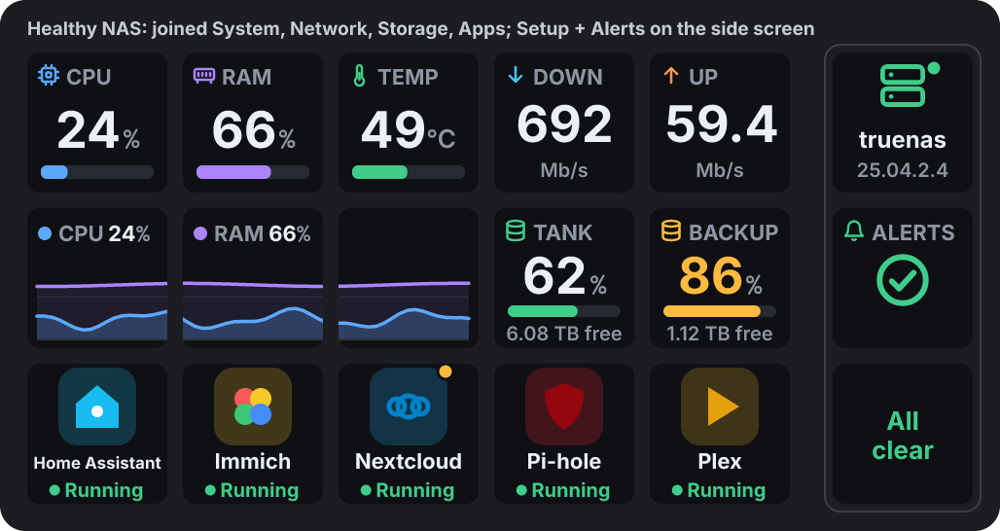

# TrueNAS plugin for the AJAZZ Stream Dock (AKP153E)

Live TrueNAS stats, storage, alerts and app controls on your Stream Dock keys.
Runs on the Stream Dock software's built-in Node.js 20 — nothing else to install.

Needs **TrueNAS 25.04 or newer** (Community Edition, formerly SCALE). It talks to
TrueNAS's own API over a secure connection (`wss://<address>/api/current`).



## Keys

| Key | Shows | Press |
|---|---|---|
| **Setup** | Connection status, NAS name and version. Holds the address and API key for all keys | Opens the TrueNAS web page |
| **System** | CPU, memory, CPU temperature, ZFS cache, uptime | Opens the TrueNAS dashboard |
| **Network** | Download / upload speed, port, peaks, graph | Opens network settings |
| **Storage pool** | Space used, free space, health, scrub/resilver progress | Opens storage |
| **Alerts** | Number of active alerts, then the alerts themselves | Opens the dashboard |
| **App** | An app's icon, name and state (colour taken from its icon) | Press: start · press twice: stop · hold: open its web page |

### Joining keys and choosing what each key shows
Keys of the same kind next to each other join into one display. Each key has a
**Shows** setting; **Automatic** picks something from the key's position:

- **System**: one key = CPU + RAM; a row = CPU, Memory, Temp, ZFS cache, Uptime; lower rows = CPU/RAM graph.
- **Network**: one key = Down + Up; a row = Download, Upload, then a graph across the rest. *Port and link* only if you choose it.
- **Storage**: no pool chosen = one pool per key, then a total. Pool chosen = How full, Free space, Health along the row.
- **Alerts**: first key counts the alerts, the rest show one alert each, worst first.
- **App**: *Automatic* keys fill in with your apps (running ones first).

Pick a specific **Shows** value on any key to override it, even inside a group.
Neighbouring keys set to *Graph* share one graph. The ~1 mm gap between keys is
allowed for, so graphs line up across keys. Main keys and the side screen never join.
Untick **Join with neighbouring keys** to keep a key on its own.

## Settings
Each key's settings only show what applies to it: *Shows* plus the port and speed
units (Network), pool (Storage), °C/°F (System) or app (App).

The **Setup** key holds the connection (address, API key, *Allow self-signed
certificate*, a status line and Retry). You only need one Setup key; every TrueNAS key uses it.

## Install / remove
From the build zip: unzip, double-click **install.bat** (closes the Stream Dock software,
copies the plugin into `%APPDATA%\HotSpot\StreamDock\plugins`, starts it again; your
keys and settings are kept). **uninstall.bat** removes it.

## Troubleshooting
The plugin writes `plugin.log` in its folder:
`%APPDATA%\HotSpot\StreamDock\plugins\com.clarkyau.truenas.sdPlugin\plugin.log`
(the API key is never written to it). App icons are cached in the `cache` folder next to it.

| Key says | Meaning |
|---|---|
| Add the Setup key / Finish the Setup key | Add the Setup key and enter the address and API key there |
| API key rejected / revoked | Make a new key in TrueNAS and paste it in |
| Certificate not trusted | Tick *Allow self-signed certificate* |
| Connection refused / Can't reach TrueNAS | Check the address; the NAS must be reachable from this PC |
| Needs TrueNAS 25.04+ | Older versions don't have the new API |

Press a key showing an error to retry immediately.

## For developers

```
npm install            # build/test tools only (esbuild, ws, pngjs, resvg, selfsigned)
npm run build          # icons + bundle -> build/TrueNAS-for-Ajazz
npm test               # runs the plugin against a fake Ajazz host + fake TrueNAS, writes previews
npm run package        # build + test + dist/*.zip (build zip and source zip)
```

`npm test -- --node "C:\path\to\node.exe"` runs the plugin under a specific Node
(use the Stream Dock software's own Node 20 to be exact).

### Layout
```
src/index.js       plugin entry: Stream Dock protocol, keys, presses, rendering loop
src/truenas.js     TrueNAS JSON-RPC client (login, live stats, pools, alerts, apps)
src/layout.js      AKP153E key-position fix + joining neighbouring keys
src/render.js      what each key draws
src/svg.js         drawing helpers, colours, icons, number formatting
src/appicons.js    downloads app icons, shrinks them, picks their colour
pi/index.html      the settings panel
assets/            manifest, names, PNG icons (made by scripts/make-icons.js)
installer/         install.bat, uninstall.bat, installer.ps1 (built-in PowerShell only)
scripts/           build.js, package.js, make-icons.js, zip.js
test/              fake-host.js, fake-truenas.js, run-tests.js, fonts.js
```

### Ajazz software rules this code follows
- Key positions arrive in hardware order: `index = row*5 + column`,
  real column `= 4 - floor(index/3)`, real row `= index % 3`; the side screen (column 5) is normal.
- Key images are 144×144 SVG data URLs (`data:image/svg+xml;charset=utf8,<svg…`).
- No `#` or `%` anywhere in an image (colours are `rgb()`, no gradients/filters). `#` in text
  is shown as `＃`; the percent sign is drawn as a shape (`pctGlyph`).
- Text is 19 px or larger (labels 22 px, big numbers ~52 px) to read well on the real keys.
- No spaces at the start or end of a text run, no `<tspan>`.
- Manifest and settings-panel changes need a restart of the Stream Dock software.

### TrueNAS API used
`auth.login_with_api_key`, `core.subscribe` → `reporting.realtime` (CPU, memory,
interfaces, ZFS), `system.info`, `pool.query`, `alert.list`, `app.query`, `app.start`, `app.stop`.
